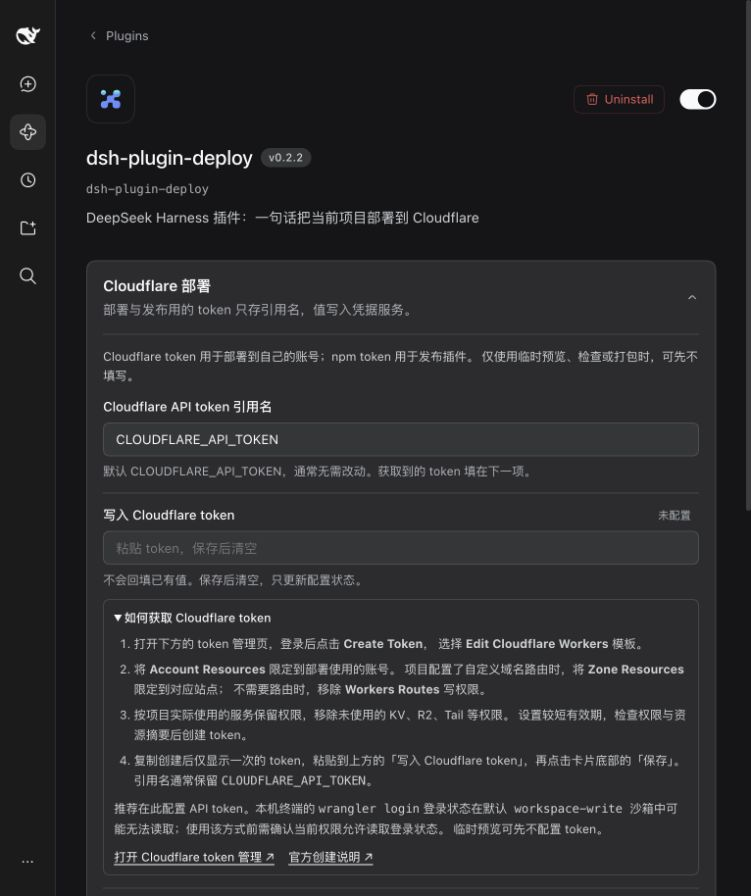
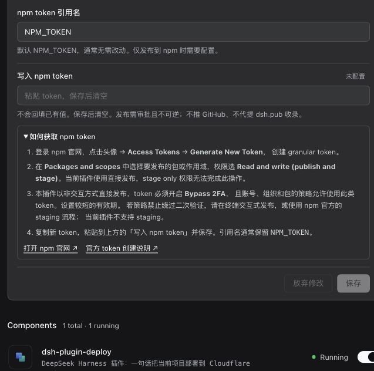
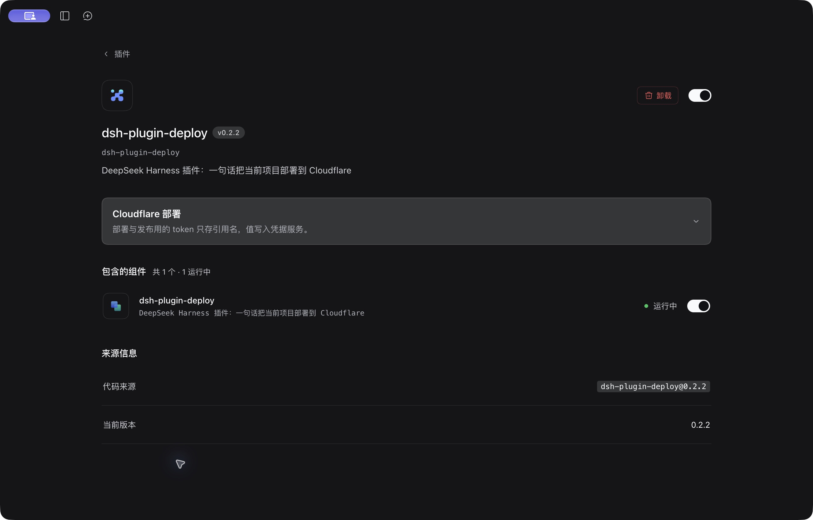
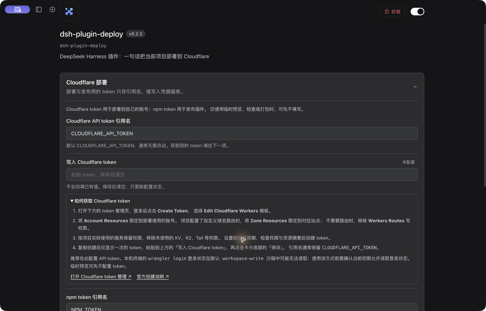
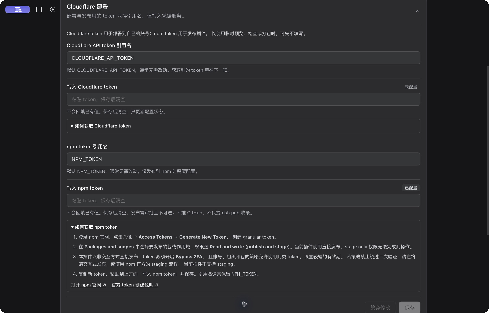
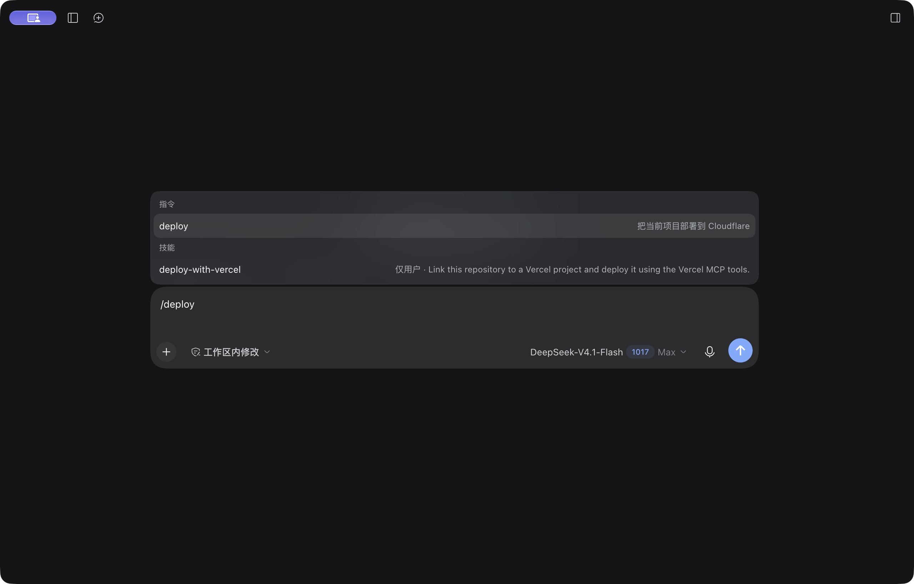
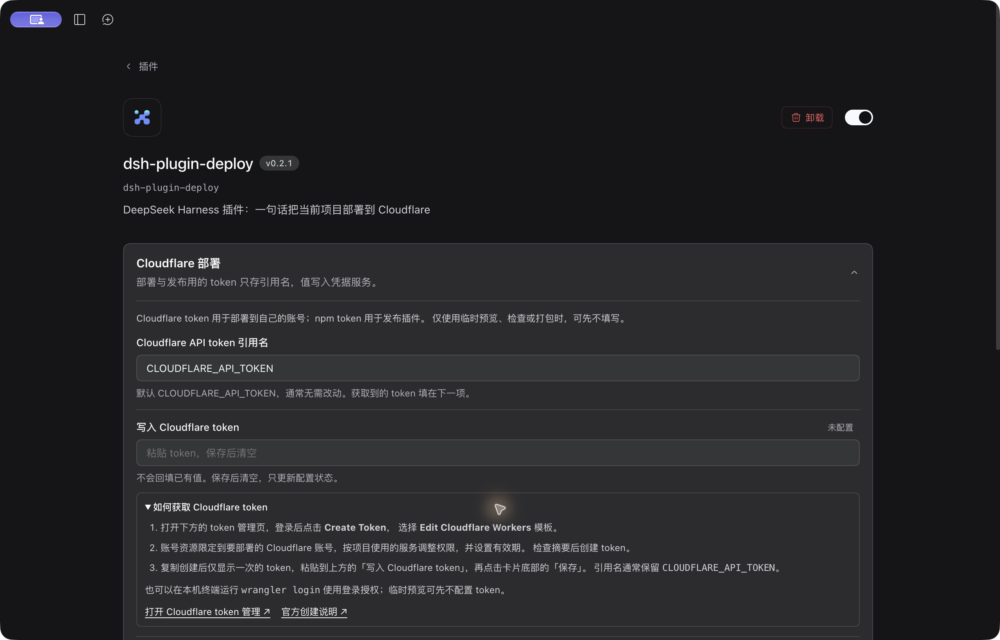
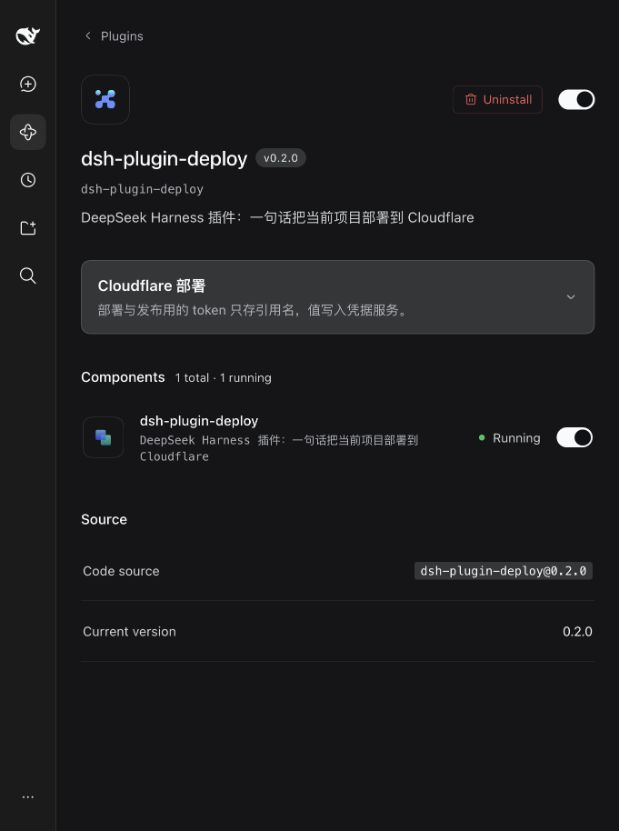

# Harness 0.2 兼容与验证记录

轨道：Host + Web UI。以下按插件版本保留独立验证记录，避免把旧版本制品或截图当作新版本证据。

## 兼容范围与问题来源

支持 `>=0.2.1-rc.2 <0.3.0-0`；本次实际验证的是 Harness **0.2.1-rc.2**，源码 commit **687f282e8625c6b8d11ff58211a90524be2e4317**。范围内其他版本没有逐个实跑；0.3 的预发布版本也不在范围内。旧 Harness 0.1.x 需使用旧插件版本。

[issue #1](https://github.com/Octo-o-o-o/dsh-plugin-deploy/issues/1) 报告 Windows 桌面版 0.2.1-rc.2 安装 npm 插件 0.1.3 时，被精确锁定的旧 DSH peer 版本拒绝。本地源码当时为尚未发布的 0.1.4，同样锁定旧接口。

原有 107 项测试通过，但把旧产物导入真实新版运行时会失败：`dsh-settings` 已不再导出 `installSettingsSection`。因此单纯扩展 peer 范围不足以修复。

## 0.2.2 修订与发行复验（2026-10-22）

**状态：已发布到 npm，`latest` 为 0.2.2；实际 desktop profile 已升级并完成配置说明和部署入口验收。**

- 核实 [PR #3 的评审反馈](https://github.com/Octo-o-o-o/dsh-plugin-deploy/pull/3#discussion_r4333240286)：设置说明、中英文 README 和 npm 发布失败提示均明确，本插件的非交互式直接发布需要有发布权限且开启 Bypass 2FA 的 granular token，并须符合账号、组织和包的策略。禁止使用此类 token 时，改用终端交互式发布或 npm 官方 staging 流程；插件尚未实现 staging。依据 [npm 直接发布要求](https://docs.npmjs.com/creating-and-publishing-unscoped-public-packages/#direct-publishing)。
- Cloudflare 说明补上 Zone Resources 范围：有路由时限制到对应站点，无路由时移除 Workers Routes 写权限；移除未使用的 KV、R2、Tail 等权限。依据 [Cloudflare 模板默认权限](https://developers.cloudflare.com/fundamentals/api/reference/template/)。同时说明默认 `workspace-write` 沙箱可能读不到本机 Wrangler 登录状态，推荐配置 API token。
- 本机 Node 22 的 118/118 项测试、TypeScript 检查、插件全量扫描和 `git diff --check` 均通过。此次只修改说明和失败提示，没有增加权限或修改发布执行方式。
- 用本机官方 **Harness 0.2.1-rc.2** 自带 CLI，在独立 `DSH_HOME` 中从最终候选 tarball 安装到全新 web profile；`--dump-config` 包含本 bundle，实际启动后显示 **v0.2.2 / 1 running**。
- 候选阶段在浏览器中分别展开两个说明，新增权限限制、沙箱限制、Bypass 2FA 要求和替代流程均完整显示，官方链接可见；保存按钮保持禁用。浏览器没有捕获到 warning / error，也没有 `loaded without registering` 或 slot 声明错误。该阶段未修改实际 desktop profile 或用户凭据。
- 发行前对用户再次提到的 #1，另用全新 profile 复验原始的不指定版本安装方式 `dsh plugin --profile <测试 profile> add dsh-plugin-deploy`：当时成功解析并安装官方 npm **0.2.1**，没有版本不兼容拒绝，当时 registry 的 `latest` 为 `0.2.1`。这证明该次 macOS 默认安装已恢复，不冒充 Windows 桌面版真机验收。#1 在 2026-10-21 已有维护者说明并关闭。





### 正式发行与实际桌面版

- [PR #4](https://github.com/Octo-o-o-o/dsh-plugin-deploy/pull/4) 已合并，合并提交 `6216049ec5a07fcf5b4837f38a6ea1e324e417bb`，代码源提交 `3815da68f671c308d90a0dc54cbf9a36df90845e`。[CI 39746676735](https://github.com/Octo-o-o-o/dsh-plugin-deploy/actions/runs/39746676735) 在 Ubuntu / Node 22 和 Windows / Node 24 均通过，包含类型检查、每组 118 项测试和插件扫描。
- [npm 0.2.2](https://www.npmjs.com/package/dsh-plugin-deploy/v/0.2.2) 于 `2026-10-22T09:00:15.921Z`（台北时间 17:00）发布，公开 registry 的 `latest` 已更新为 `0.2.2`。SHA-1 为 `0956b0a544ff230067a5e77e016ade91d94d5cbc`，SHA-1 和 SHA-512 integrity 均匹配已验证的发行 tarball；其中 7 个文件与合并的代码一致。
- 在退出官方 Harness **0.2.1-rc.2** 桌面版、备份实际 desktop profile 后，使用该桌面版自带 CLI 执行 `dsh plugin --profile desktop add dsh-plugin-deploy@0.2.2 --registry=https://registry.npmjs.org`。从官方 npm 下载并安装成功，profile 依赖为精确版本 `0.2.2`，7 个安装文件逐字节匹配发行 tarball。未使用 Harness 兼容性豁免；pnpm 为此次明确指定的新版本添加了单独的冷却期排除项，保留整体供应链策略。
- 重启实际桌面版后，插件详情显示 **v0.2.2 / 共 1 个 · 1 运行中**，来源是 **dsh-plugin-deploy@0.2.2**。Cloudflare 和 npm 两份说明均能展开并完整显示步骤、权限限制、沙箱限制和官方链接；查看后保存按钮保持禁用。
- 在插件项目的空白会话中，输入 `/deploy` 和 `/publish-plugin` 均显示对应指令与正确说明；已有会话的「部署或检查发布」菜单可展开，包含「部署到 Cloudflare」与「检查插件发布」。验证草稿已清空，没有提交部署或发布指令。
- 安装及重启后，profile patch、已有插件 bundle 和凭据文件与安装前保持一致。保留 0.2.1 发行包和 profile 备份用于恢复。此次真机验收覆盖 macOS 桌面安装、运行、配置说明和入口；没有新建 Cloudflare 云资源，也未将其记为 Windows 桌面 UI 或插件内 npm 发布流程验收。
- PR #3 中对应的 4 条评审反馈已逐条回复并标记为已解决；PR #4 没有未解决的评审线程。









## 0.2.1 发行与桌面版复验（2026-10-21）

- [PR #3](https://github.com/Octo-o-o-o/dsh-plugin-deploy/pull/3) 增加了设置页内的 Cloudflare / npm token 配置说明，已合并到 `main`。源提交 `4e9f83334406e9db2715dbc70058c46d3ad0198d`，合并提交 `2536a05de2e337c8fe8f3aca30c027bcd9825f6e`。
- [npm 0.2.1](https://www.npmjs.com/package/dsh-plugin-deploy/v/0.2.1) 于 `2026-10-21T05:09:23.577Z` 发布。发行 tarball 与 registry 的 SHA-1 均为 `172c49313deba1a3ad9bed9e1f0101c915989fde`，SHA-512 integrity 也一致。发布当时的 `latest` 已更新到 `0.2.1`。
- [CI 39547440044](https://github.com/Octo-o-o-o/dsh-plugin-deploy/actions/runs/39547440044) 的 Ubuntu / Node 22、Windows / Node 24 均通过，包含类型检查、每组 118 项测试和插件扫描。
- 使用官方 Harness **0.2.1-rc.2** 自带 CLI，将实际使用的 `desktop` profile 从本地预览 tarball 切换到官方 npm 的精确版本 `dsh-plugin-deploy@0.2.1`；安装后 7 个文件与发行 tarball 逐字节一致。
- 重启官方桌面版后，插件详情显示 **v0.2.1**、**1 running**，安装来源为 `dsh-plugin-deploy@0.2.1`；两个配置说明均能展开，创建步骤和官方链接可见。查看说明后保存按钮仍禁用，没有提交配置修改。
- 安装与重启前后的 profile patch、已有插件 bundle 以及凭据文件均保持一致。仅核验本地显示与安装，不把本次结果记为真实 npm 发布功能、Cloudflare 公网部署或 Windows 桌面 UI 验收。



## 0.2.0 迁移与验证历史（2026-10-21）

下文中的 tarball、哈希、截图和运行时结果均属于 **0.2.0**。

### 实施内容

| 位置 | 当前行为 |
| --- | --- |
| 安装合同 | 显式声明 `engines.dsh`，DSH peers 使用相同的有界范围；开发依赖固定到实际验证版本 |
| Host 配置 | 用 Config `.volatile()` 声明可编辑字段，每次操作开始读取 `.get()`；引用名按凭据服务的标识符规则验证 |
| 命令执行 | `shell.execute(shell.resolve(request))` 后等待句柄 `result()`；沿用宿主沙箱、截止时间和取消信号 |
| 设置入口 | 新版插件详情页的 `plugins.bundle.config`，通过 `configForms` 绑定 Loader 行 |
| 凭据桥 | `remote.credentials.describe(refs)` / `set(ref, value)`，读取 `{ ok, value }`，写入被拒绝时保留输入并显示失败 |
| 设置并发 | 两个引用名一次提交，使用编辑开始时的 revision；外部修改保留本地草稿，过期提交由宿主拒绝 |
| 生命周期 | 控制器订阅、远程事件和 CSS 均在插件卸载时清理；丢弃过期凭据查询结果 |
| 当前目录 | 使用 `workingDirectory.get(session)`，支持会话内切换目录后的部署、发布和相对路径 |
| Windows | PowerShell 单引号转义；临时预览同时隔离 HOME、USERPROFILE、APPDATA、LOCALAPPDATA、XDG_CONFIG_HOME |
| 发布检查 | 新增 `dsh-compat`，直接调用宿主 `evaluatePluginCompatibility`，在打包或发布前拦截与当前运行时不兼容的声明 |
| 包脚本 | 插件内的检查、打包和发布均带 `--ignore-scripts`；不执行被检查包的生命周期脚本，作者需先构建产物 |
| 制品 | `prepack` 自动构建；提交 Host / client 产物；补充英文 README；补上完整的 11 个客户端平台 externals |

保留部署条款确认、一次性审批、凭据只经环境传给子进程、失败关闭及输出脱敏。

### 已取得的本地证据

使用本机已安装的官方桌面版自带 CLI 和运行时，在独立 `DSH_HOME` 中建立测试 profile。未替换用户现有 CLI，也未修改用户正常使用的 desktop profile。

- 原始基线：107/107 测试通过；新版运行时导入旧产物失败，保留初始失败记录。
- `dsh plugin --profile compat add <本仓绝对路径>` 成功，未使用版本豁免；`--dump-config` 包含本 bundle。
- 使用桌面版自带运行时真正启动 web profile：插件详情显示 **v0.2.0**，组件 **1 running**，设置卡片实际出现。
- 两个测试引用名保存后写入 profile patch；重启后 Host 仍读取到这两个值。
- 从真实工具注册表取得 `deploy`、`publish_plugin`，命令注册表包含 `deploy`、`publish-plugin`。
- 在真实 Host 中调用 `publish_plugin` 的 `check` 和 `pack`：两种模式均通过 **9/9** 检查，后者产生真实 tarball。不是 shell mock。
- 迁移后测试包含版本拒绝、未来版本边界、过期配置、保存拒绝、凭据响应乱序、卸载清理、当前目录、Windows 引号和扫描范围回归。
- Node 22 与桌面版自带的 Node 24 均为 118/118 测试通过；隔离的干净源码副本执行 `npm ci`、类型检查、118 项测试和扫描均通过。
- 最终 tarball 安装到另一全新 web profile 后再次启动，工具、配置恢复、`check`、`pack` 均通过；带有写文件 prepack 脚本的测试包未产生脚本标记文件。
- 发行 tarball 共 7 个文件，SHA-1 `f7bfd541c49d8567dad60aa4ba834f8f092e586c`。最后仅修订英文 README，已逐字节核对 Host、client、manifest、patch 与真机安装包完全一致。
- TypeScript 检查通过。扫描器会检查所有跟踪文件，跳过 Git 忽略的本机笔记；初始扫描命中的既有内部笔记未被修改或提交。
- 事实层重新生成：100 个 slot、82 个事件、11 个平台模块、19/19 合同锚点。生成器已随本仓保存，适配了新版源码位置。

### 发布与 registry 复验

- [PR #2](https://github.com/Octo-o-o-o/dsh-plugin-deploy/pull/2) 已合并；[GitHub Actions](https://github.com/Octo-o-o-o/dsh-plugin-deploy/actions/runs/39535779543) 的 Linux / Node 22、Windows / Node 24 两组均成功，包含类型检查、118 项测试和扫描。
- [npm 0.2.0](https://www.npmjs.com/package/dsh-plugin-deploy/v/0.2.0) 已于 `2026-10-21T03:03:23.570Z` 发布，registry 的 `latest` 已指向 `0.2.0`；公开的 SHA-1 和 SHA-512 integrity 与最终发行 tarball 一致。
- 在另一全新 profile 中执行官方桌面版自带 CLI 的 `plugin --profile compat-registry add dsh-plugin-deploy@0.2.0` 成功，未使用 Harness 版本兼容豁免。安装后的 7 个文件逐字节匹配发行 tarball。
- 发布后立即尝试不指定版本的命令时，本机 pnpm 的 `minimumReleaseAge: 1440` 使其选回旧版 `0.1.3` 并被 Harness 拒绝；显式指定 `@0.2.0` 后成功。因此新包冷却期内应使用上面的精确版本命令。
- 从 registry 安装的插件在实际运行时启动成功，浏览器显示 `v0.2.0`、`1 total · 1 running`，来源为 `dsh-plugin-deploy@0.2.0`。两个工具、两个命令与保存的配置引用均正常读取。
- registry 安装后的 `check`、`pack` 均成功，8 项阻塞检查全部通过；第 9 项 `version-available` 如实提示 `0.2.0` 已被占用，在这两种模式中为非阻塞提示。生命周期脚本隔离测试也再次通过。



### 验证边界

本次在 macOS 上验证了本机官方 0.2.1-rc.2 的安装、运行时、浏览器界面、配置持久化与真实打包流程。没有把这些结果记为 Windows 桌面版真机验收，也没有重新向 Cloudflare 上传网站或新建云资源。Windows / Linux 的 GitHub Actions 检查结果单独以远端实际运行记录为准。TUI、headless 交互提供方和模型驱动的公网部署未在本次重跑。

## 复现

```sh
npm ci
npm run typecheck
npm test
npm run check

# 使用 0.2.1-rc.2，避免 PATH 中的其他旧 CLI。
npx @deepseek-ai/dsh@0.2.1-rc.2 --profile deploy-test --from-default-profile web --help
npx @deepseek-ai/dsh@0.2.1-rc.2 plugin --profile deploy-test add "$PWD"
npx @deepseek-ai/dsh@0.2.1-rc.2 --profile deploy-test --dump-config
npx @deepseek-ai/dsh@0.2.1-rc.2 --profile deploy-test --no-open

# 更新事实层：源码仓可以位于任意目录。
node tools/gen-harness-facts.mjs --repo <harness-clone> --ref <commit> --out .dsh-assistant/reference --npm
```


