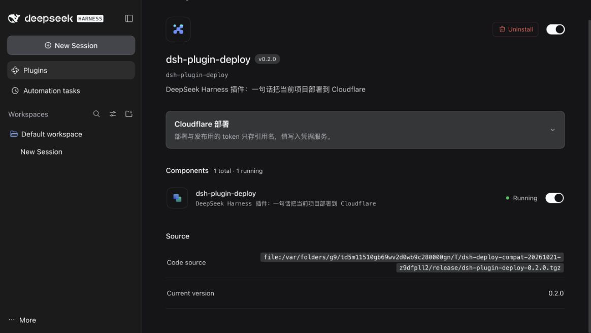

# Harness 0.2 兼容与验证记录

日期：2026-10-21（Asia/Taipei）。插件候选版本：0.2.0。轨道：Host + Web UI。

## 兼容范围与问题来源

支持 `>=0.2.1-rc.2 <0.3.0-0`；本次实际验证的是 Harness **0.2.1-rc.2**，源码 commit **687f282e8625c6b8d11ff58211a90524be2e4317**。范围内其他版本没有逐个实跑；0.3 的预发布版本也不在范围内。旧 Harness 0.1.x 需使用旧插件版本。

[issue #1](https://github.com/Octo-o-o-o/dsh-plugin-deploy/issues/1) 报告 Windows 桌面版 0.2.1-rc.2 安装 npm 插件 0.1.3 时，被精确锁定的旧 DSH peer 版本拒绝。本地源码当时为尚未发布的 0.1.4，同样锁定旧接口。

原有 107 项测试通过，但把旧产物导入真实新版运行时会失败：`dsh-settings` 已不再导出 `installSettingsSection`。因此单纯扩展 peer 范围不足以修复。

## 实施内容

| 位置 | 当前行为 |
| --- | --- |
| 安装合同 | 显式声明 `engines.dsh`，DSH peers 使用相同的有界范围；开发依赖固定到实际验证版本 |
| Host 配置 | 用 Config `.volatile()` 声明可编辑字段，每次操作开始读取 `.get()`；引用名按凭据服务的标识符规则验证 |
| 命令执行 | `shell.execute(shell.resolve(request))` 后等待句柄 `result()`；沿用宿主沙箱、截止时间和取消信号 |
| 设置入口 | 新版插件详情页的 `plugins.bundle.config`，通过 `configForms` 绑定 Loader 行 |
| 凭据桥 | `remote.credentials.describe(refs)` / `set(ref, value)`，读取 `{ ok, value }`，写入被拒绝时保留输入并显示失败 |
| 设置并发 | 两个引用名一次提交，使用编辑开始时的 revision；外部修改保留本地草稿，过期提交由宿主拒绝 |
| 生命周期 | 控制器订阅、远程事件和 CSS 均在插件卸载时清理；丢弃过期凭据查询结果 |
| 当前目录 | 使用 `workingDirectory.get(session)`，支持会话内切换目录后的部署、发布和相对路径 |
| Windows | PowerShell 单引号转义；临时预览同时隔离 HOME、USERPROFILE、APPDATA、LOCALAPPDATA、XDG_CONFIG_HOME |
| 发布检查 | 新增 `dsh-compat`，直接调用宿主 `evaluatePluginCompatibility`，在打包或发布前拦截与当前运行时不兼容的声明 |
| 包脚本 | 插件内的检查、打包和发布均带 `--ignore-scripts`；不执行被检查包的生命周期脚本，作者需先构建产物 |
| 制品 | `prepack` 自动构建；提交 Host / client 产物；补充英文 README；补上完整的 11 个客户端平台 externals |

保留部署条款确认、一次性审批、凭据只经环境传给子进程、失败关闭及输出脱敏。

## 已取得的本地证据

使用本机已安装的官方桌面版自带 CLI 和运行时，在独立 `DSH_HOME` 中建立测试 profile。未替换用户现有 CLI，也未修改用户正常使用的 desktop profile。

- 原始基线：107/107 测试通过；新版运行时导入旧产物失败，保留初始失败记录。
- `dsh plugin --profile compat add <本仓绝对路径>` 成功，未使用版本豁免；`--dump-config` 包含本 bundle。
- 使用桌面版自带运行时真正启动 web profile：插件详情显示 **v0.2.0**，组件 **1 running**，设置卡片实际出现。
- 两个测试引用名保存后写入 profile patch；重启后 Host 仍读取到这两个值。
- 从真实工具注册表取得 `deploy`、`publish_plugin`，命令注册表包含 `deploy`、`publish-plugin`。
- 在真实 Host 中调用 `publish_plugin` 的 `check` 和 `pack`：两种模式均通过 **9/9** 检查，后者产生真实 tarball。不是 shell mock。
- 迁移后测试包含版本拒绝、未来版本边界、过期配置、保存拒绝、凭据响应乱序、卸载清理、当前目录、Windows 引号和扫描范围回归。
- Node 22 与桌面版自带的 Node 24 均为 118/118 测试通过；隔离的干净源码副本执行 `npm ci`、类型检查、118 项测试和扫描均通过。
- 最终 tarball 安装到另一全新 web profile 后再次启动，工具、配置恢复、`check`、`pack` 均通过；带有写文件 prepack 脚本的测试包未产生脚本标记文件。
- 发行 tarball 共 7 个文件，SHA-1 `f7bfd541c49d8567dad60aa4ba834f8f092e586c`。最后仅修订英文 README，已逐字节核对 Host、client、manifest、patch 与真机安装包完全一致。
- TypeScript 检查通过。扫描器会检查所有跟踪文件，跳过 Git 忽略的本机笔记；初始扫描命中的既有内部笔记未被修改或提交。
- 事实层重新生成：100 个 slot、82 个事件、11 个平台模块、19/19 合同锚点。生成器已随本仓保存，适配了新版源码位置。

## 验证边界

本次在 macOS 上验证了本机官方 0.2.1-rc.2 的安装、运行时、浏览器界面、配置持久化与真实打包流程。没有把这些结果记为 Windows 桌面版真机验收，也没有重新向 Cloudflare 上传网站或新建云资源。Windows / Linux 的 GitHub Actions 检查结果单独以远端实际运行记录为准。TUI、headless 交互提供方和模型驱动的公网部署未在本次重跑。

## 复现

```sh
npm ci
npm run typecheck
npm test
npm run check

# 使用 0.2.1-rc.2，避免 PATH 中的其他旧 CLI。
npx @deepseek-ai/dsh@0.2.1-rc.2 --profile deploy-test --from-default-profile web --help
npx @deepseek-ai/dsh@0.2.1-rc.2 plugin --profile deploy-test add "$PWD"
npx @deepseek-ai/dsh@0.2.1-rc.2 --profile deploy-test --dump-config
npx @deepseek-ai/dsh@0.2.1-rc.2 --profile deploy-test --no-open

# 更新事实层：源码仓可以位于任意目录。
node tools/gen-harness-facts.mjs --repo <harness-clone> --ref <commit> --out .dsh-assistant/reference --npm
```

发布状态及获取方式以 npm registry 和 issue 的最终处理记录为准。


